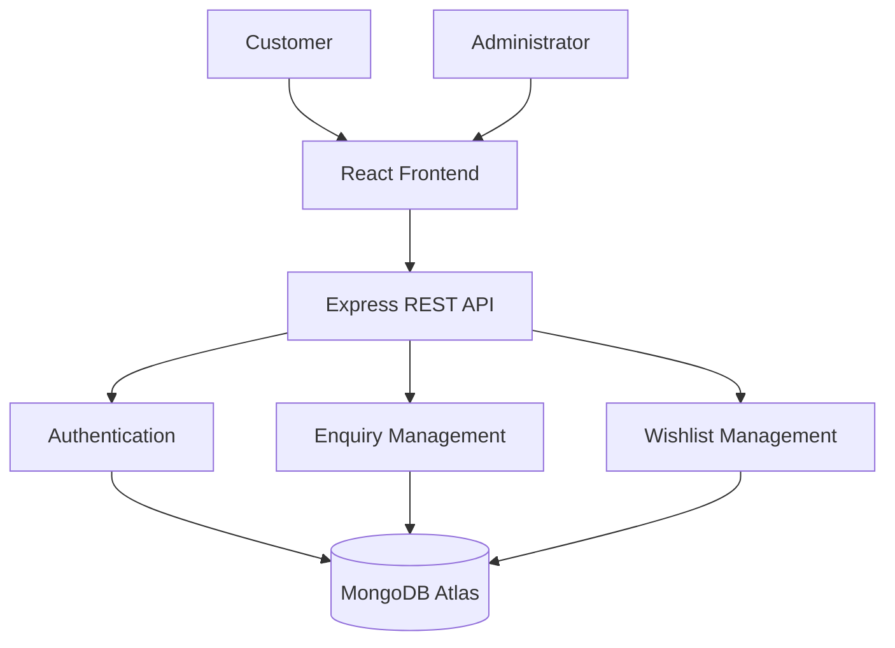

# VEYRA — Beyond the Ordinary

A cinematic, full-stack travel platform designed to deliver an immersive destination discovery and travel enquiry experience.

## Live Demo

https://veyra-travel.vercel.app

## About the Project

VEYRA combines premium visual design with functional backend services to create a modern travel platform.

Users can explore destinations, discover travel experiences, create accounts, save favourite destinations and submit travel enquiries through an integrated booking enquiry system.

The platform also provides an admin dashboard for managing customer enquiries.

## Key Features

### Customer Experience
- Cinematic and responsive user interface
- Interactive destination discovery
- Dynamic destination pages
- Destination-specific photo galleries
- Travel package pricing
- International destination previews
- Customer registration and login
- Personal account dashboard
- Persistent wishlist functionality
- Travel booking enquiry system
- Frontend and backend phone number validation

### Admin Dashboard
- Admin authentication
- Centralized customer enquiry dashboard
- Database-backed enquiry management

## Technology Stack

| Category | Technologies |
|---|---|
| Frontend | React.js, Vite, JavaScript |
| Styling | CSS3 |
| Animations | GSAP |
| Routing | React Router |
| Icons | Lucide React |
| Backend | Node.js, Express.js |
| Database | MongoDB Atlas, Mongoose |
| Authentication | JWT, bcrypt |
| Frontend Hosting | Vercel |
| Backend Hosting | Render |
| Version Control | Git, GitHub |

## System Architecture



## Destinations

- Nandi Hills
- Chikkamagaluru
- Coorg
- Ooty
- Goa
- Kerala
- Lakshadweep

### International Collection — Coming Soon

- Bali
- Japan
- Switzerland
- Italy
- Maldives

## Deployment

The application is deployed using cloud-based services:

- Frontend: Vercel
- Backend: Render
- Database: MongoDB Atlas

## Run Locally

Clone the repository:

```bash
git clone https://github.com/harshhika-7/veyra-travel.git
cd veyra-travel
npm install
npm run dev
```

Install backend dependencies:

```bash
cd server
npm install
```

Create a `.env` file inside the server directory with the following configuration:

```env
PORT=5000
MONGODB_URI=your_mongodb_connection_string
ADMIN_EMAIL=your_admin_email
ADMIN_PASSWORD_HASH=your_password_hash
JWT_SECRET=your_jwt_secret
CLIENT_URL=http://localhost:5173
```

Update the frontend API URLs to point to your local backend when testing locally.

Start the backend:

```bash
node index.js
```

## Project Highlights

- Full-stack MERN architecture
- REST API integration
- Database-backed user accounts
- Responsive web development
- Customer and admin workflows
- Client-side and server-side validation
- Cloud deployment

## Future Scope

- International travel packages
- Online payment integration
- Email notifications
- OTP verification
- Advanced itinerary management

## Disclaimer

VEYRA is a portfolio demonstration project.
Travel enquiries are for demonstration purposes only
and do not constitute actual travel reservations.

Please use fictional personal information while testing.

---

VEYRA — For the places you'll go.
